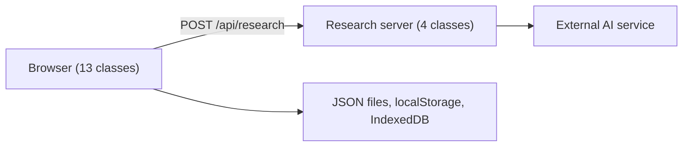

# Al-Arba'in: Interactive Nawawi Hadith Reader

**الأربعون النووية**

> تطبيق ويب لقراءة الأحاديث الـ42 ودراستها والاستماع إليها، مع معاني الكلمات والإعراب والشروح، ومساعد ذكي يجيب عن الأسئلة ويعرض مراجعه من المصادر.

Al-Arba'in is a responsive web application for reading and studying Imam an-Nawawi's collection of 42 hadith. It brings the Arabic source text, commentary, word-by-word study, human recordings and personal study records into one reader. A contextual assistant explains supported meanings using the bundled sources and always shows its references.

This is a Software Engineering course project. The code is plain JavaScript organised as classes and ES Modules, with a small server for the assistant.

## Features

- **Read**: browse all 42 hadith, search by number, Arabic title, wording or topic, and resume where you stopped. Two facing pages on wide screens, one page on narrow screens.
- **Study**: tap any word for Arabic and English learning meanings, grammatical notes, context and every occurrence in the collection. Open attributed commentary and takhrij beside the text.
- **Listen**: 84 human recordings, 42 each by Ahmad Al-Nufais and Al-Husaini Academy. Playback speed, repeat, seeking, automatic next-hadith playback and optional word-by-word highlighting.
- **Offline**: the interface and text work offline through a Service Worker. Recordings can be downloaded per hadith or per reciter and are verified by size and SHA-256 before they are saved.
- **Personal records**: bookmarks, notes, reading progress and read/memorized status, stored only in your browser. Export and import a JSON backup. You can also add your own recording for a hadith.
- **Assistant**: ask about the meaning of a word or the context of a hadith. Each answer cites its source passages, which you can open and inspect.
- **Languages**: Arabic and English interface. The hadith text and titles always stay Arabic.

## Architecture

17 classes in total: 13 run in the browser and 4 on the server.



| Layer | Classes | Role |
| --- | --- | --- |
| Controllers | `ReaderController`, `AudioController`, `LanguageController`, `ResearchController` | Navigation, playback, language and the assistant panel |
| View | `ReaderView` | Renders the catalogue, reading pages and detail panels |
| Services | `HadithService`, `StudyService`, `AudioDownloadService` | Search, study records, verified downloads |
| Repositories | `HadithRepository`, `StudyRepository`, `AudioRepository` | JSON content, localStorage, IndexedDB |
| Audio | `AudioPlayer`, `SeekControl` | The active audio session and seeking |
| Server | `ResearchService`, `EvidenceRepository`, `AIClient`, `AnswerValidator` | Planning, source retrieval, generation and validation |

Dependencies such as repositories, storage and `fetch` are passed into constructors, which keeps the classes easy to test in isolation.

### How the assistant answers

1. The browser sends the question, its language and the open hadith (if any) to `POST /api/research`.
2. The server validates the request. A word that matches a saved meaning is located locally; any other question lets the model pick up to six relevant hadith out of all 42.
3. The commentary sections and word meanings for those hadith are retrieved from the bundled sources.
4. The model writes a short explanation from those passages. Contextual questions get an extra review step.
5. `AnswerValidator` checks the structure and every reference. The server, not the model, builds the reference labels.

If generation fails for a word with a saved meaning, the saved meaning is shown and clearly labelled as source content rather than as a generated answer. The assistant uses no live web search, embeddings or vector database.

## Getting started

Requires Node.js 24 (`package.json` accepts 22.13 or newer).

```sh
npm install
npm run dev
```

Open `http://localhost:5173` or the address printed in the terminal.

### Enable the assistant

Reading and text search work without any key. The assistant needs internet access, an API key and available quota.

1. Copy `.env.example` to `.dev.vars`.
2. Put your key after `AI_API_KEY=`.
3. Restart the server.

```dotenv
AI_API_KEY=
AI_MODEL=gemini-3.5-flash-lite
AI_AUTO_FALLBACK=true
```

The current provider is Google Gemini, isolated in `server/ai-client.mjs`. With `AI_AUTO_FALLBACK=true`, a temporary failure of the default model retries with `gemini-3.6-flash` and then `gemini-3.8-flash`. It does not retry on a bad key, a usage limit or a cancelled request. `.dev.vars` is listed in `.gitignore`. Never commit or share your key.

### Reading-only mode

Python 3 is enough to read and search without the assistant:

```sh
python3 serve.py        # on Windows you can also run START_WINDOWS.bat
```

Then open `http://127.0.0.1:8000`. This serves `public/` only and does not provide `/api/research`. Do not open `index.html` by double-clicking it, because the app needs an HTTP server to load its JSON files and ES Modules.

### Other commands

| Command | Purpose |
| --- | --- |
| `npm test` | Run the automated tests |
| `npm run build` | Build the server and worker output |
| `npm start` | Run the built output locally through Wrangler (a local preview, not a public deployment) |

## Testing

`npm test` runs 67 checks covering domain logic, repositories, study records, module bindings, language switching, playback, word timings, offline behaviour, verified downloads and assistant validation. The UI tests use jsdom with mocked media APIs, and the assistant tests use controlled responses.

These checks do not replace a listening review of the highlighting or a test against the live AI service.

## Project structure

```text
app/api/research/route.ts   HTTP route that connects the assistant to the server classes
server/                     ResearchService, EvidenceRepository, AIClient, AnswerValidator, meaning search
public/
  app.mjs                   Entry point
  js/                       controllers, views, services, repositories, audio, utils
  *.json                    Hadith, commentary, meanings, grammar notes, recording timings
  audio/  fonts/  licenses/ Recordings, local fonts, third-party notices
tests/  tools/              Automated tests and the test runner
scripts/  worker/           Install, run and build tooling
docs/                       Sources and project-structure notes
```

Content is kept as data, separate from the code. If you edit hadith text, keep identifiers and word positions stable, because meanings, grammar notes and timings refer to them.

## Content and sources

| Content | Source |
| --- | --- |
| Hadith text and takhrij | [Sunnah.com, Forty Hadith of an-Nawawi](https://sunnah.com/nawawi40) |
| Commentary (116 pages) | Ibn Daqiq al-'Eid, *Sharh al-Arba'in al-Nawawiyyah*, Muassasat al-Rayyan, 6th ed., 1424 AH / 2003 CE. [Text on Shamela](https://shamela.ws/book/11244) |
| Grammar notes (2,021) | Hosni Abd al-Jalil Yusuf, *I'rab al-Arba'in Hadithan al-Nawawiyyah*, al-Mukhtar, 1st ed., 1424 AH / 2003 CE. [Scan](https://archive.org/details/lis_e3r15/lis_e3r1505/). Earlier analyses by Umar al-Umari remain where available |
| Word meanings | Short learning glosses in Arabic and English for 2,870 word positions, written for this project |
| Extra word sources | [Sibt](https://binbaz.org.sa/audios/2282) (Ibn Baz) and [Rayhanah](https://hadeethenc.com/ar/browse/hadith/11170) (HadeethEnc) |
| Recordings | Ahmad Al-Nufais ([reference](https://www.youtube.com/watch?v=omKbTQhmjTA)) and Al-Husaini Academy ([reference](https://www.youtube.com/watch?v=rZtYSb0s32k)) |

Details and coverage limits are in [`docs/SOURCES.md`](docs/SOURCES.md) (Arabic). The file layout guide is [`docs/PROJECT_STRUCTURE_AR.md`](docs/PROJECT_STRUCTURE_AR.md) (Arabic).

## Known limitations

- Grammar coverage is partial. Positions without a note are marked and link to the source.
- English word meanings are educational glosses, not a published translation of the collection.
- Word highlighting uses automatically generated timings: about 93% of words are aligned for each reciter (2,684 of 2,870 for Al-Nufais, 2,679 for Al-Husaini). Unaligned words are not highlighted, and the timings have had no manual listening review.
- The assistant is a study aid. It does not give personal religious rulings. Validation checks the answer structure and references, not the correctness of every conclusion.
- The research endpoint validates the request method, origin, content type and input size, but has no built-in rate limiting. Add rate limiting at your hosting layer before deploying publicly, since each question can trigger several AI calls.

## License and credits

No license has been chosen for this project's own code yet. Third-party notices are kept in [`public/licenses/`](public/licenses/): the Al-Nufais audio collection (MIT), Amiri Quran and Noto Sans Arabic (SIL OFL) and the SHA-256 library (MIT). Keep them when you redistribute the assets they cover.

## Authors

Ali Omari and Ibrahim Sarran, Software Engineering course project.
